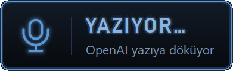
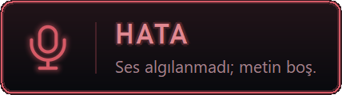
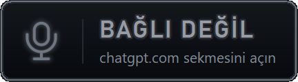

<p align="center">
  <a href="README.md"></a>
  <a href="README.tr.md"></a>
</p>

# voice-type: her pencereye sesle yazma (Windows)

Kısayola bas, konuş, tekrar bas: söylediğin, o an odakta olan pencereye (terminal, editör, tarayıcı)
yapıştırılır ya da yalnızca panoya kopyalanır. Türkçe/İngilizce karışık konuşmayı ve yazılım terimlerini
iyi çözer. Terminalde Claude Code / Codex gibi araçlara sesle komut vermek için yazıldı.

Uygulama Rust ile yazılmış tek bir EXE'dir (`rust/`): ~460 KB, tek süreç, boşta ~2 MB özel bellek,
çalışma zamanı bağımlılığı yok.

## Yöntemler

Rozete ya da tepsi simgesine sağ tıklayıp seçilir; seçim hatırlanır.

| | **OpenAI API** (önerilen) | **ChatGPT sekmesi** (deneysel) |
|---|---|---|
| Nasıl | Mikrofon kaydı doğrudan OpenAI ses-metin API'sine (`gpt-4o-transcribe`) | Chrome eklentisi, açık ChatGPT sekmesindeki dikte düğmesini kullanır |
| Ücret | Kullanım başına (API faturası) | ChatGPT hesabının dikte sınırları |
| Gerekenler | `OPENAI_API_KEY` | Chrome + eklenti + açık chatgpt.com sekmesi |

> **ChatGPT sekmesi yöntemi hakkında:** Bu yöntem ChatGPT web arayüzünü programla kullanır (düğmeye
> koddan basar, metni sayfadan okur). OpenAI Kullanım Koşulları, çıktının otomatik ya da programla
> alınmasını yasaklar; bu yüzden yöntem varsayılan değildir, kişisel deney olarak bırakılmıştır ve
> kullanımı kendi sorumluluğunuzdadır. Koşullarla uyumlu yol OpenAI API yöntemidir.

## Kullanım

| Kısayol | İş |
|---|---|
| **Ctrl+Alt+Space** | Dikteyi başlat / bitir ve yapıştır |
| **Ctrl+Alt+Enter** | Bitir, yapıştır ve Enter gönder |
| **Ctrl+Alt+Backspace** | İptal |

Kısayolları değiştirmek için rozete veya tepsi simgesine sağ tıklayıp **Kısayolları değiştir** menüsünden
işlemi seçin ve yeni tuş birleşimine basın. Durum penceresindeki kısayol satırlarına tıklayarak da
değiştirebilirsiniz. **Esc** vazgeçer; **Varsayılanlara dön** ilk kısayolları geri getirir.
Seçimler EXE'nin yanındaki `dikte-ayarlar.json` dosyasında saklanır ve yeniden açıldığında korunur.

Metin, bitirme kısayoluna bastığın anda odakta olan pencereye gider: konuşmaya başla, hedef pencereye
geç, bitir. Ctrl+V ile yapıştırılır (yalnızca Alacritty ve WezTerm'de Ctrl+Shift+V). Satır sonları korunur; yalnızca terminallerde metin tek satıra indirilir. Sağ tıktan **yalnızca
panoya kopyala** seçilirse hiçbir tuş gönderilmez.

## Rozet

Ekranda küçük bir mikrofon karesi durur; rengi durumu gösterir. Okunacak bir şey olunca (yapıştırıldı,
kopyalandı, hata, izin bekleniyor) kendiliğinden, fareyle üstüne gelince de yumuşakça açılır ve iki
kısayolu birden gösterir. Sürükleyip istediğin yere bırakabilirsin: en yakın ekran kenarına yapışır
(köşeler dahil, görev çubuğunun üstüne çıkmaz) ve yeri hatırlanır. Tıklamak ya da tepsi simgesine çift
tıklamak durum penceresini, sağ tık menüyü açar.

| Durum | Rozet | Açık hâli (fare üstünde / kendiliğinden) |
|---|:---:|---|
| **Hazır**<br><sub>boşta; üstüne gelince iki kısayol</sub> |  |  |
| **Dinliyor**<br><sub>kayıt sürüyor, nokta yanıp söner</sub> |  |  |
| **Yazıyor**<br><sub>ses yazıya dökülüyor</sub> |  |  |
| **Yapıştırıldı**<br><sub>4 sn kendiliğinden açılır</sub> |  |  |
| **Kopyalandı**<br><sub>yalnızca kopyala modu; kendiliğinden açılır</sub> |  |  |
| **Hata**<br><sub>kendiliğinden açılır, mesajın tamamı</sub> |  |  |
| **Başlıyor**<br><sub>ChatGPT sekmesi: mikrofon açılıyor</sub> |  |  |
| **İzin bekleniyor**<br><sub>ChatGPT sekmesi: Chrome'da mikrofona izin ver; kendiliğinden açılır</sub> |  |  |
| **Bağlı değil**<br><sub>ChatGPT sekmesi: chatgpt.com sekmesi yok</sub> |  |  |

<sub>Görseller uygulamanın kendi çizim koduyla üretilir: `cargo test badge_shots -- --ignored`
(`rust/tools/rgba_to_png.py`).</sub>

## Kurulum

1. EXE'yi derle ([rustup](https://rustup.rs) + Visual Studio Build Tools) ya da GitHub Actions'taki
   `ChatGPT-Dikte-exe` yapıtını indir:

   ```powershell
   cd rust
   cargo build --release      # rust\target\release\ChatGPT-Dikte.exe
   ```

2. Yerel anahtar dosyasını üret (EXE'nin yanında `bridge-config.json`; eklentiyle yerel köprü bunu
   kullanır): `python make_config.py`, sonra EXE'yi `dist\` klasöründen başlat.
3. **OpenAI API:** https://platform.openai.com/api-keys adresinden anahtar al ve
   `setx OPENAI_API_KEY "sk-..."` çalıştır. Sağ tık → **Dikte: OpenAI API**. Daha ucuz model için
   `dist\dikte-ayarlar.json` dosyasına `"openai_model": "gpt-4o-mini-transcribe"` ekle.
4. **ChatGPT sekmesi (isteğe bağlı):** `chrome://extensions` → Geliştirici modu → Paketlenmemiş öğe
   yükle → `extension\`. Sekmede bir kez giriş yap ve mikrofon izni ver.

Ayrıntılar, uçtan uca deneme listesi ve ölçüm betiği: [rust/README.md](rust/README.md).

## Teknik

- **Rust, düz Win32:** kısayollar `RegisterHotKey`, arayüz GDI (neon tema, durum değişmedikçe çizim
  yok), pano ve tuşlar `SendInput`. Mikrofon winmm `waveIn`, HTTPS Windows'un WinHTTP'si; TLS ya da ses
  kütüphanesi gömülmez. Bağımlılıklar: `windows-sys`, `serde_json`.
- **Durum makinesi platformdan bağımsız** (`rust/src/bridge.rs`): Windows'a dokunan her şey bir trait
  arkasında, bu yüzden 51 birim testi her yerde çalışır; mikrofon ve HTTPS için ayrıca elle çalıştırılan
  donanım testleri var (`cargo test -- --ignored`). CI her push'ta Windows'ta test edip EXE üretir.
- **Yerel köprü** (ChatGPT sekmesi yöntemi): yalnızca `127.0.0.1` üzerinde dinler, istekleri kurulum
  başına rastgele anahtarla doğrular. Dikte edilen metin günlüğe yazılmaz.
- Simgeler kodla çizilir (`rust/src/icon.rs`, SDF ile yumuşatılmış); eklenti PNG'leri aynı koddan
  üretilir ve test edilir.

| | Python sürümü (eski) | Rust sürümü |
|---|---|---|
| EXE | ~18 MB | ~0,46 MB |
| Süreç | 2 | 1 |
| Boşta bellek | ~62 MB | ~2 MB özel (~12 MB working set) |

## Eski Python sürümleri

Kökteki Python dosyaları ilk sürümlerdir ve başvuru için duruyor: `browser_bridge.py` + `tray_app.py`
(ChatGPT sekmesi köprüsü, PyInstaller ile EXE) ve `voice_type.py` (ilk OpenAI API sürümü). Rust sürümü
aynı HTTP protokolünü konuştuğu için eklenti ikisiyle de çalışır.
